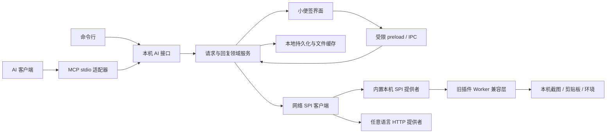

# human_cli 架构

human_cli 是由 AI 管理的人机协作工具。AI 创建、更新、取消请求；人读取说明、操作辅助工具、附图回复并完成。只有未完成任务显示便签；完成或取消即销毁窗口，不提供主界面、托盘或用户创建便签的入口。

## 模块

| 目录或文件 | 职责 |
| --- | --- |
| `core/` | 请求、版本检查、便签缓存和日志、用户丢弃、附件、持久化；不依赖 Electron/MCP |
| `adapters/` | MCP、CLI、本机 AI 接口；不执行插件代码 |
| `scripts/windows-cli.c` | 原生 Windows 控制台入口 human_cli.exe，转发 stdin/stdout/stderr 与退出码，使用包内运行时 |
| `plugins/config-ui.mjs` | 配置界面清单、同源 URL 和提交数据校验 |
| `plugins/ui-sessions.mjs` | 配置会话、保存冲突、持久化结果和断线恢复；不依赖 Electron |
| `desktop/config-ui.mjs` | 隔离网页容器、共用区域布局、权限与窗口生命周期 |
| `plugins/network-host.mjs` | 通过 HTTP SPI 发现插件、校验配置、开始/查询/取消任务及复制结果 |
| `plugins/spi-rpc.mjs` | JSON-RPC、认证、连接故障检测、二进制线格式 |
| `plugins/spi-server.mjs` | Node 参考提供者，用来暴露内置及兼容旧插件 |
| `plugins/host.mjs`、`worker.mjs` | 旧 Node 插件的兼容提供者内部执行层 |
| `plugins/builtin/` | 内置侧栏功能，统一暴露为本机网络 SPI |
| `desktop/` | 按需窗口、进程生命周期、系统能力、保存文件与 IPC |
| `src/` | 便签、主题、通用插件配置和结果、缓存/丢弃界面 |
| `examples/spi-python/` | 无 human_cli/Node 依赖的独立 Python 提供者 |

渲染进程启用 context isolation 与 sandbox，不接触 Node、任意 IPC 或文件路径。主进程验证调用来源；附件通过 ID 协议读取。外部插件的代码只运行在提供者进程中，human_cli 接收清单、状态和结果。web 配置页面另在独立隔离渲染容器显示，不获得便签 preload、Node、长期令牌或全局 IPC。

AI 接口与插件接口是两条不同链路。本机 AI HTTP 接口绑定 loopback 随机端口，使用随机令牌并拒绝浏览器 Origin。SPI 客户端向用户配置的提供者地址发起连接；不把本机 AI 接口暴露到外网。

## 请求与缓存

请求状态为 pending → completed / cancelled；回复缓存状态为 not_ready → saved → discarded。没有交付确认、回执或已读状态。AI 自己判断工具调用是否成功。

core/cache.mjs 为每张便签维护 cache/<requestId>/request.json，完成后写入 reply.json，附件复制到同目录的 attachments 下。JSON 原子写入、UTF-8 编码，包含附件绝对路径；AI 不依赖运行中的桌面端即可读取。state.json 仍是可恢复的持久状态，启动时重建缓存并迁移旧版记录。

human_logs / GET /logs 按创建时间倒序返回标题、时间、状态和缓存位置，支持 limit/offset 分页。AI 重启后即使不知道 requestId，也能定位自己需要的文件。为避免猜测传输是否成功，所有回复统一保存；读取不删除缓存。

用户可明确丢弃缓存回复，删除 reply.json、回复文字和诊断，以及不再被独立工具结果引用的图片。请求日志和独立工具结果保留，标记 discarded；丢弃不冒充 AI 取消，也不能撤回此前已被读取的内容。

adapters/human.mjs 统一 CLI 与 MCP 的协助语义：request/human_request 默认创建后等待最终回复。后台创建是显式选项，CLI 为 --background，MCP 为 background: true。human_wait 用于恢复或补取图片，不是正常请求的必需第二步。

请求不设用户完成期限。human_wait 等到用户完成或 AI 取消；连接断开只清理监听。MCP 宿主可能有自己的超时，AI 可重新连接读取缓存日志，或通过原 requestId 再次取回。大图片仍分页回传。

AI 更新说明增加 version，用户完成携带看到的版本；idempotencyKey 避免重试创建重复窗口。AI 更新/取消或用户完成会尽力停止相应插件作业，后到结果不能污染已完成回复快照。

## 网络插件

清单和线协议见 [PLUGINS.md](PLUGINS.md)、[SPI.md](SPI.md)。一个提供者可提供多个插件，配置使用 JSON Schema。新增语言或服务不需要修改核心、IPC 或前端分支。

流程为 describe → start → status → 复制结果到本机 → forget。runId 支持幂等，cancel 用于尽力终止远端作业。单次连接的故障检测不是整个作业或用户的时间上限；网络插件没有固定总运行期限。

内置本机服务自动启动，截图等本机能力在其内部实现。旧 manifest.json/plugin.mjs 目录由内置服务中的 Worker 兼容，Worker 故障隔离与能力门控仍保留，但不是第三方 Node 的安全沙箱。

## 原生窗口和主题

纸面约 320 × 360 DIP，加两侧书签共 380 × 360 DIP。左键运行，右键共用详情区域；不自动抢换当前内页。临时收起最小化到任务栏。完成/取消后销毁窗口；没有未完成任务且 HTTP 响应传完后进程退出。详见 [LIFECYCLE.md](LIFECYCLE.md)。

保存正常窗口 bounds、显示器 ID、工作区和 scaleFactor。Electron 坐标已是 DIP，不重复乘 DPI。显示器断开时按交集或主屏恢复，夹到工作区；监听显示器增减与度量变化。Windows 初次无边框调整被校正，尺寸落在可表示 DPI 网格，避免反复恢复时累积变大。

Windows 截图使用 Electron 提供的物理显示器矩形和固定 System.Drawing 桥，执行前隐藏所有便签，结束后恢复。其他平台保留 desktopCapturer 能力实现，但发行和原生验收当前针对 Windows。四种主题通过语义颜色变量切换，持久化并广播到所有窗口。界面已迁移用户提供的新稿，并保留原来的小便签默认尺寸；详见 [UI-REBUILD.md](UI-REBUILD.md)。

## 数据

默认 `%LOCALAPPDATA%\human_cli`，可用 HUMAN_CLI_DATA_DIR 覆盖。state.json 保存请求、回复、偏好和插件配置；attachments 保存原始附件；cache 保存按便签组织的 JSON 与附件副本；plugins/providers.json 配置网络服务；runtime.json 保存本次 AI 接口地址和令牌。

目前是本机单用户、单写者的原子 JSON 存储。网络插件可以在其他机器；AI 请求通道本身尚未扩展成远程多租户服务。未实现热重载、自动安装外部服务、签名安装器或自动更新。

实现参考：[JSON-RPC 2.0](https://www.jsonrpc.org/specification)、[Electron 安全边界](https://www.electronjs.org/docs/latest/tutorial/security/)、[MCP SDK stdio](https://ts.sdk.modelcontextprotocol.io/server)。实际覆盖范围见 [VERIFICATION.md](VERIFICATION.md)。

## 发布入口

human_cli-desktop.exe 是桌面入口；human_cli.exe 是原生控制台入口，普通子命令运行包内 CLI，mcp 子命令运行包内 MCP stdio 服务。启动器通过 CreateProcessW 直接启动同目录运行时，按 Windows CRT 规则传递参数，不拼接 shell 命令，不依赖 PATH 中的 node.exe。子进程继承标准流，控制台启动器等待并返回其退出码。

复用内置运行时依据 [Electron ELECTRON_RUN_AS_NODE](https://www.electronjs.org/docs/latest/api/environment-variables#electron_run_as_node)。开发打包使用 MinGW-w64 GCC 构建启动器，静态链接编译器支持库；用户无需安装该编译器或 Node。

## 自定义配置界面

默认 schema 表单保持原交互。web 模式通过 SPI 配置会话获取提供者页面，宿主以 WebContentsView 嵌入共用配置标签；插件页面只通过自己的同源 HTTP 服务编辑草稿。宿主查询 submitted、校验版本/配置冲突/Schema、持久化后 resolve，失败保持原配置；退出结束会话。详细状态与消息见 [CONFIG-UI.md](CONFIG-UI.md)。
